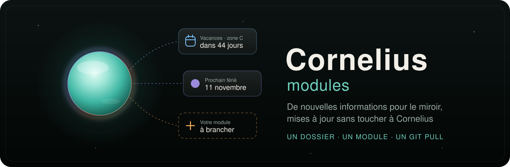

<div align="center">



<h3>De nouvelles informations pour le miroir, mises à jour sans toucher à Cornelius.</h3>

<p>
  <a href="https://github.com/lfpoulain/Cornelius"></a>
  
  
  
  <a href="LICENSE"></a>
</p>

<p>
  <a href="#-les-modules">Les modules</a> ·
  <a href="#-installer">Installer</a> ·
  <a href="#-créer-un-module">Créer un module</a> ·
  <a href="#-compatibilité">Compatibilité</a> ·
  <a href="#-documentation">Documentation</a> ·
  <a href="#-licence">Licence</a>
</p>

</div>

---

[Cornelius](https://github.com/lfpoulain/Cornelius) est le miroir intelligent de la famille. Il répond à la voix et affiche des cartes : l’heure, la météo, le prochain bus… Ces informations viennent de **modules**.

Cornelius livre ses modules de base avec lui. Ce dépôt accueille **tous les autres** : chacun est un dossier, Cornelius les charge au démarrage, et un `git pull` suffit à les mettre à jour, sans toucher au miroir.

## 📦 Les modules

| Module | Ce qu’il fait | Jeton | Fiche |
| --- | --- | --- | --- |
| 📅 **Agenda** | Les prochains rendez-vous d’un agenda Google, iCloud ou Outlook, par son lien iCal privé, répétitions comprises ; « et samedi ? » se demande à la voix | lien privé | [agenda](agenda/README.md) |
| 📜 **Éphéméride** | Ce qui s’est passé un jour comme aujourd’hui, l’anniversaire le plus rond d’abord, d’après Wikipédia | aucun | [ephemeride](ephemeride/README.md) |
| 🗑️ **Poubelles** | Quel bac sortir et quand, d’après le calendrier de la commune écrit en toutes lettres, encombrants compris ; rappel la veille au soir | aucun | [poubelles](poubelles/README.md) |
| ⛽ **Prix des carburants** | Les prix d’une station-service, carburant principal d’abord ou celui demandé (« et le SP98 ? ») ; station trouvée par commune ou code postal | aucun | [carburants](carburants/README.md) |
| 📰 **Titres de l’actualité** | Les premiers titres d’un journal, d’après son flux RSS ou Atom (franceinfo par défaut) | aucun | [actu](actu/README.md) |
| 🏖️ **Vacances et jours fériés** | En vacances ou pas, prochaines vacances scolaires de la zone, prochain jour férié ; affichage permanent possible | aucun | [vacances](vacances/README.md) |
| 🚲 **Vélos en libre-service** | Vélos (mécaniques, électriques) et places libres d’une station : Vélib’, V’Lille, Vélo’v, STAR, TBM… (norme GBFS) | aucun | [velos](velos/README.md) |
| ▶️ **YouTube** | La dernière vidéo d’une chaîne (par défaut, Les Frères Poulain), avec ou sans les Shorts | aucun | [youtube](youtube/README.md) |

Livrés avec Cornelius, et donc absents d’ici : Heure, Météo, Transports, Ragator. Voir [Les modules](https://github.com/lfpoulain/Cornelius/blob/main/docs/modules/README.md) dans Cornelius.

## 🚀 Installer

Clonez ce dépôt **à côté** du dossier de Cornelius :

```bash
git clone https://github.com/lfpoulain/cornelius-modules.git
```

```text
📁 GitHub/
├── 📁 cornelius/            le miroir, avec ses modules livrés (addons/)
└── 📁 cornelius-modules/    ce dépôt : un dossier par module
```

Redémarrez Cornelius. Les modules apparaissent dans **Administration → Modules**, avec leur nom et leur icône, à côté des modules livrés. Ils se règlent comme eux : une ou plusieurs sources, un propriétaire, un jeton si le fournisseur en demande un.

> [!TIP]
> Pour ranger ce dépôt ailleurs, indiquez son chemin dans le `.env` de Cornelius : `CORNELIUS_MODULES_DIR=/chemin/vers/cornelius-modules`.

## 🔄 Mettre à jour

```bash
git -C cornelius-modules pull
```

Redémarrez ensuite Cornelius : les modules ne sont lus qu’au démarrage. Les sources déjà réglées sont gardées, et reprises si la forme des réglages a changé.

> [!IMPORTANT]
> Les modules 1.1.0 demandent **Cornelius 0.2.0** : mettez Cornelius à jour avant, ou en même temps que ce dépôt.

Un module qui demande une version de Cornelius plus récente que celle installée n’est pas chargé. L’administration l’indique en bas de **Modules**, sous « Module non chargé », avec la version attendue : il suffit alors de mettre Cornelius à jour.

## 🧩 Créer un module

```sh
cp -r _template parking
```

Le gabarit `_template` est un module complet relié à un fournisseur fictif, avec ses schémas, une réponse d’exemple et ses tests. Remplacez le fournisseur, adaptez les schémas et les tests, puis vérifiez :

| Commande | Effet |
| --- | --- |
| `npm test` | Lance les tests de tous les modules avec le vrai cœur de Cornelius (`createTestModule` : base en mémoire, horloge réglable, réseau simulé) |
| `npm run check` | Vérifie les types contre le contrat de Cornelius |
| `npm run format` | Met le code en forme, avec les règles de Cornelius |

Rien à installer ici : ces commandes utilisent les outils du Cornelius voisin, où `npm ci` doit avoir été lancé. S’il est rangé ailleurs, indiquez son dossier dans `CORNELIUS_DIR`.

Le pas à pas complet est dans [Créer un module](docs/creer-un-module.md), et la façon de proposer un module dans [Contribuer](CONTRIBUTING.md).

## 🔗 Compatibilité

Un module dépend de Cornelius par trois alias, toujours résolus vers le Cornelius qui le charge :

| Alias | Contenu |
| --- | --- |
| `#cornelius/addons` | Le contrat : types, `AddonCollectError` |
| `#cornelius/validation` | La compilation des schémas JSON |
| `#cornelius/testing` | Pour les tests : `createTestModule` (le module dans le vrai cœur, horloge et réseau simulés), et `validateAddonDefinition`, `openDatabase`, `AddonRepository`, `AddonRuntime` |

- `apiVersion: 1` est le contrat. Il ne change qu’en cas de rupture : un module d’une autre version est refusé.
- `minCoreVersion`, facultatif, est la version minimale de Cornelius pour un module qui s’appuie sur un ajout récent du cœur. Les modules de ce dépôt demandent `'0.2.0'` : présentation dans l’administration, listes du formulaire, précisions à la voix, fuseau du foyer, affichage recalculé à l’heure dite.
- Un module externe ne remplace jamais un module livré : s’il en reprend l’identifiant, il est refusé.

Les règles complètes vivent dans Cornelius, à côté du code qu’elles décrivent : [référence du contrat des modules](https://github.com/lfpoulain/Cornelius/blob/main/docs/modules/reference.md).

## 🔒 Sécurité

- 🧑‍💻 Un module s’exécute dans le serveur de Cornelius, avec les mêmes droits que lui : n’installez que des modules dont vous avez lu le code ou connaissez l’auteur.
- 🌐 Le cœur leur impose son client HTTP (adresses http(s) sans identifiants, trois redirections au plus et jamais vers une adresse non chiffrée, réponses bornées) et valide tout ce qu’ils renvoient.
- 🔑 Leurs jetons restent dans le `.env` ou l’administration de Cornelius, jamais dans ce dépôt.

## 📚 Documentation

| | |
|---|---|
| **Écrire** | [Créer un module](docs/creer-un-module.md) · [Fiche à remplir](_template/README.md) · [Contribuer](CONTRIBUTING.md) |
| **Le contrat** | [Référence](https://github.com/lfpoulain/Cornelius/blob/main/docs/modules/reference.md) · [Types](https://github.com/lfpoulain/Cornelius/blob/main/shared/addons.ts) |
| **Utiliser** | [Les modules dans Cornelius](https://github.com/lfpoulain/Cornelius/blob/main/docs/modules/README.md) : sources, jetons, affichage permanent |
| **Suivre** | [Historique des changements](CHANGELOG.md) |

## 📜 Licence

Ce dépôt est distribué, comme Cornelius, sous la [PolyForm Noncommercial License 1.0.0](LICENSE) : utilisation, partage et modification libres pour un usage non commercial, en gardant la ligne `Required Notice` du fichier `LICENSE`. Les données des fournisseurs gardent leur propre licence, indiquée dans la fiche de chaque module.
